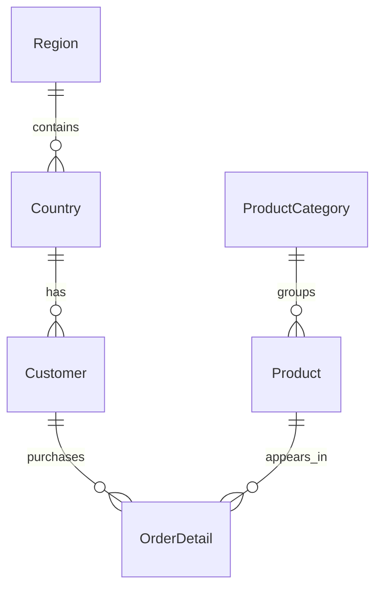
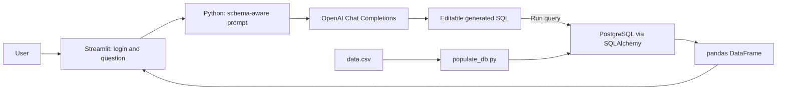

# AI-Powered SQL Query Assistant for Customer Sales Analytics

## Project Overview

This Streamlit application lets a user ask questions about customer and sales data in plain English. It sends the question and a description of the PostgreSQL schema to the OpenAI API, presents the generated SQL for inspection and editing, and runs it only when the user clicks **Run query**. Results appear as a table. A separate Python loader builds the relational database from the checked-in sales dataset. The project demonstrates a natural-language analytics workflow built with Python, Streamlit, PostgreSQL, SQLAlchemy, and the OpenAI API.

## Problem Statement

Answering business questions from a relational database usually requires knowing its table names, join paths, and SQL syntax. This interface makes exploration easier by drafting SQL from a natural-language question while keeping a review step between generation and execution. The generated SQL is fallible; users should inspect it and work with a database account whose permissions match the intended use.

## Key Features

- Shared-password login using a bcrypt hash stored in Streamlit secrets.
- Natural-language-to-SQL generation with the schema and join guidance included in the model prompt.
- Editable SQL preview and an explicit **Run query** action before database execution.
- Tabular query results and a session-only history of questions and generated SQL, with load, rerun, and delete actions.
- PostgreSQL schema creation and data loading from `data.csv` through `populate_db.py`.
- A connection-check script that runs `SELECT version()` against the configured PostgreSQL server.

The app does **not** implement charts, CSV downloads, persistent query history, or SQL safety validation.

## Technology Stack

| Technology | Role |
| --- | --- |
| Python | Application and database-loading scripts |
| Streamlit | Login, question editor, SQL review, results, and session history |
| OpenAI Python SDK | Chat Completions call that drafts SQL |
| PostgreSQL | Customer-sales relational database |
| SQLAlchemy, psycopg2, pandas | Database connection and tabular query results |
| bcrypt | Password hashing and comparison |
| python-dotenv | Loads `.env` for the standalone database scripts |

The exact Python package list is in [`requirements.txt`](requirements.txt). The [development-container configuration](.devcontainer/devcontainer.json) uses a Python 3.11 image; the project does not otherwise pin a Python version or dependency versions.

## Dataset and Database Schema

[`data.csv`](data.csv) is a **tab-separated** file despite its `.csv` extension. It has **91 source records** plus a header. Each record contains customer and location fields alongside semicolon-separated lists of products, categories, descriptions, prices, quantities, and dates. The repository's `read_raw_data` function expands those lists into **621,806 parsed order-line tuples** before database-key matching and insertion. These are source/parser counts, not verified row counts in a live PostgreSQL database.

| Source column | Meaning / loader behavior |
| --- | --- |
| `Name` | Split at the first space into first and last name |
| `Address`, `City` | Customer address fields |
| `Country`, `Region` | Geographic dimension values |
| `ProductName` | Semicolon-separated product names |
| `ProductCategory`, `ProductCategoryDescription` | Semicolon-separated category names and descriptions |
| `ProductUnitPrice` | Semicolon-separated values parsed as floats |
| `QuantityOrderded` | Semicolon-separated quantities parsed as integers; spelling matches the source header |
| `OrderDate` | Semicolon-separated dates; eight-digit `YYYYMMDD` strings become `YYYY-MM-DD` |

The loader uses **column positions**, not the header text, and pairs list elements with `zip`. Invalid numeric entries are skipped; unmatched list lengths are truncated to the shortest input. It collects distinct region, country, customer, category, and product values, creates the tables below, then inserts order lines by looking up customer and product IDs. The parsed sets contain 9 regions, 21 country-region pairs, 91 customer tuples, 8 category tuples, and 77 product tuples; actual inserted counts have not been checked against a running database.

| Table | Key fields | Relationship |
| --- | --- | --- |
| `Region` | `RegionID` primary key, `Region` | Parent of `Country` |
| `Country` | `CountryID` primary key, `Country`, `RegionID` foreign key | Each country references a region |
| `Customer` | `CustomerID` identity primary key, name/address/city, `CountryID` foreign key | Each customer references a country |
| `ProductCategory` | `ProductCategoryID` primary key, name and description | Parent of `Product` |
| `Product` | `ProductID` primary key, name, unit price, `ProductCategoryID` foreign key | Each product references a category |
| `OrderDetail` | `OrderID` primary key, `CustomerID` and `ProductID` foreign keys, date, quantity | Each row is a product line for a customer; there is no separate order-header table |



`populate_db.py` **drops and recreates all six tables** before loading the data. Its dimension ID maps use country name, customer full name, and product name as lookup keys, so name collisions can associate later order lines with an unintended record. The database's revenue calculation in the prompt uses `QuantityOrdered * ProductUnitPrice`; the schema has no recorded historical sale price or product cost.

## System Architecture



The database loader and the web app are separate programs. `utils.py` reads `.env` for loader and connection-test scripts. The Streamlit app reads `st.secrets` for its database credentials, API key, and password hash.

## How the Application Works

1. **Start and authenticate:** `streamlit_app.py` reads required Streamlit secrets, renders a password form, and checks the entered password with `bcrypt.checkpw`. A successful check sets `st.session_state.logged_in` for that browser session.
2. **Ask a question:** The user enters a question in the Streamlit text area and clicks **Generate SQL**. Empty submissions receive a warning.
3. **Generate SQL:** `generate_sql_with_gpt` sends the question, a hard-coded six-table schema, and SQL instructions to the OpenAI Chat Completions API.
4. **Review:** The returned text is stored with the question in session history and shown in an editable SQL text area. Generating SQL does **not** execute it.
5. **Execute:** Clicking **Run query** passes the edited SQL to `run_query`, which uses `pandas.read_sql_query` with a SQLAlchemy PostgreSQL engine. A successful call shows the returned row count and a table; an exception is shown as an error.
6. **Reuse:** The history panel can load generated SQL back into the editor, run it again, or remove that entry. History is held only in Streamlit session state and stores questions and SQL, not result tables.

## Natural Language to SQL Generation

The app calls `client.chat.completions.create` with model **`gpt-4o-mini`** and temperature **0.1**. The prompt names each table and column, asks for quoted PostgreSQL identifiers and correct joins, defines revenue as `"QuantityOrdered" * "ProductUnitPrice"`, and asks for `LIMIT 100` on large results. These are **prompt instructions**, not enforced SQL rules. The schema text is maintained manually in `streamlit_app.py`; the app does not inspect the live database schema.

The response is passed to `extract_sql_from_response`, which trims whitespace and attempts to strip Markdown SQL fences. Its current regular expression does not reliably remove fenced output. OpenAI request exceptions are shown in Streamlit and stop that generation attempt. Database exceptions are also displayed, but the app does not validate SQL syntax, limit queries in code, or restrict execution to `SELECT`. The edited SQL is sent to PostgreSQL with the configured account's permissions.

## Example Business Questions

These are **illustrative SQL examples**, not captured app outputs. All use tables and fields defined in `populate_db.py`.

| Question | Representative SQL | Result |
| --- | --- | --- |
| What is total sales revenue? | `SELECT SUM(od."QuantityOrdered" * p."ProductUnitPrice") AS revenue FROM "OrderDetail" od JOIN "Product" p ON p."ProductID" = od."ProductID";` | One aggregate value based on current product unit prices |
| Which products generate the most revenue? | `SELECT p."ProductName", SUM(od."QuantityOrdered" * p."ProductUnitPrice") AS revenue FROM "OrderDetail" od JOIN "Product" p ON p."ProductID" = od."ProductID" GROUP BY p."ProductID", p."ProductName" ORDER BY revenue DESC LIMIT 10;` | Ten product rows at most |
| Which countries have the highest sales revenue? | `SELECT c."Country", SUM(od."QuantityOrdered" * p."ProductUnitPrice") AS revenue FROM "OrderDetail" od JOIN "Customer" cu ON cu."CustomerID" = od."CustomerID" JOIN "Country" c ON c."CountryID" = cu."CountryID" JOIN "Product" p ON p."ProductID" = od."ProductID" GROUP BY c."CountryID", c."Country" ORDER BY revenue DESC;` | Revenue grouped by country |
| Which customers have the most purchased line items? | `SELECT cu."CustomerID", cu."FirstName", cu."LastName", COUNT(*) AS line_items FROM "OrderDetail" od JOIN "Customer" cu ON cu."CustomerID" = od."CustomerID" GROUP BY cu."CustomerID", cu."FirstName", cu."LastName" ORDER BY line_items DESC LIMIT 10;` | Ten customer rows at most |

The UI's sample prompt about **gross margin** cannot be answered faithfully from this schema because it has no cost field.

## Project Structure

```text
AI-SQL-Assistant-Customer-Sales-Analytics/
|-- readme.md                         Project documentation
|-- data.csv                          Tab-separated customer and sales source data
|-- streamlit_app.py                  Login, SQL generation, editor, execution, results
|-- populate_db.py                    PostgreSQL schema and data loader
|-- utils.py                          Database URL from .env for scripts
|-- test_render_database.py           PostgreSQL connection check
|-- generate_password.py              Interactive bcrypt hash generator
|-- requirements.txt                  Python dependencies
|-- sample.env                        Configuration template
|-- .gitignore                        Local secrets, environments, caches
`-- .devcontainer/
    `-- devcontainer.json             Python development container and port forwarding
```

No screenshots or saved query-result examples are checked into the repository.

## Installation and Prerequisites

You need Python, a reachable PostgreSQL database, and OpenAI API access. Create an **empty, dedicated database** before loading the included data. The repository does not provide a PostgreSQL container or an automated database provisioning script. A hosted PostgreSQL service such as Render or a local PostgreSQL installation can be used if you have the connection details.

Create a virtual environment and install dependencies from the repository root:

```bash
python -m venv .venv
```

Activate it:

```bash
# macOS / Linux
source .venv/bin/activate
```

```powershell
# Windows PowerShell
.\.venv\Scripts\Activate.ps1
```

```bash
python -m pip install -r requirements.txt
```

### Environment Variables

[`sample.env`](sample.env) lists all six settings. The standalone scripts use `.env` through `python-dotenv`; the web app reads the same names from `.streamlit/secrets.toml` through `st.secrets`. Configure **both files** if you intend to run the loader/test scripts and the app. Both paths are ignored by Git.

| Setting | Used by | Required for | Placeholder example |
| --- | --- | --- | --- |
| `POSTGRES_USERNAME` | Scripts and app | Database connection | `sales_user` |
| `POSTGRES_PASSWORD` | Scripts and app | Database connection | `your_db_password` |
| `POSTGRES_SERVER` | Scripts and app | Database connection | `localhost:5432` |
| `POSTGRES_DATABASE` | Scripts and app | Database connection | `sales_analytics` |
| `OPENAI_API_KEY` | App | SQL generation | `your_api_key` |
| `HASHED_PASSWORD` | App | Login | `your_bcrypt_hash` |

On macOS/Linux, create local templates with:

```bash
cp sample.env .env
mkdir -p .streamlit
cp sample.env .streamlit/secrets.toml
```

On Windows PowerShell:

```powershell
Copy-Item sample.env .env
New-Item -ItemType Directory -Force .streamlit | Out-Null
Copy-Item sample.env .streamlit/secrets.toml
```

Fill in the four PostgreSQL settings in both files, and the API key and password hash in `.streamlit/secrets.toml`. The files can use different database accounts: the loader in `.env` needs schema-creation and insert privileges, while the app can use a read-only account. The quoted `KEY="value"` form in `sample.env` also works as TOML for the Streamlit secrets file. Run `python generate_password.py` to enter a login password interactively and copy **only the resulting bcrypt hash** into `HASHED_PASSWORD`. Keep both local configuration files private; never commit raw passwords or API keys.

## Running the Application

From the repository root, first verify database connectivity:

```bash
python test_render_database.py
```

This script reads `.env`, connects to PostgreSQL, and prints the server version if successful. Next, populate the dedicated database:

```bash
python populate_db.py
```

**This command drops and recreates `OrderDetail`, `Product`, `ProductCategory`, `Customer`, `Country`, and `Region` before loading `data.csv`. Do not run it against a database containing data you need to keep.** It prints parser counts and completion status. Finally, start Streamlit:

```bash
python -m streamlit run streamlit_app.py
```

Open the local URL printed by Streamlit, normally `http://localhost:8501`. Enter the password used to generate `HASHED_PASSWORD`, submit a business question, inspect or edit the SQL, and click **Run query** to see the table. The app needs access to both the OpenAI API and PostgreSQL.

## Authentication and Security

`generate_password.py` creates a salted bcrypt hash. The app compares an entered password to `HASHED_PASSWORD` from Streamlit secrets and records a Boolean login flag in session state. This is a single shared password, with no individual accounts, roles, or application-level rate limiting. `.env` and `.streamlit/` are ignored by Git, while `sample.env` contains blank placeholders.

The SQL editor accepts arbitrary edits, and `run_query` performs no read-only or allowlist check. The prompt's `LIMIT 100` request is not an execution limit. Use a PostgreSQL role restricted to the intended tables and operations, preferably read-only for the app. Database and API exception text may be displayed to users. The development-container configuration disables Streamlit CORS and XSRF protection for its preview command; assess that configuration before exposing the app beyond a trusted development environment.

## Deployment

The existing setup notes mention Render as one possible **PostgreSQL host**. The repository includes no Render deployment manifest and no evidence of a live hosted app. The [development container](.devcontainer/devcontainer.json) installs requirements, starts Streamlit, and forwards port 8501; it is a development convenience, not a production deployment configuration. For any hosted Streamlit instance, configure the six secrets in the host's secret manager and grant the app only the database permissions it needs.

## Testing and Validation

- `python test_render_database.py` checks connectivity by running `SELECT version()`; it does not validate the schema or data.
- After populating a disposable database, inspect the six tables and row counts with a PostgreSQL client, then run the app and test a simple question such as total sales revenue.
- Review the generated SQL before clicking **Run query** and compare its result with a hand-written SQL query for the same question.

There is no automated test suite or recorded accuracy evaluation for natural-language-to-SQL generation in this repository.

## Results and Capabilities

The code supports password-gated question entry, AI-generated SQL preview and editing, manual query execution, DataFrame display, and session query history. The checked-in dataset has **91 source records** and yields **621,806 parsed order-line tuples** through the loader, but no database snapshot or execution log verifies final inserted row counts. No query-generation accuracy, execution-success rate, response-time benchmark, saved result table, or screenshot is included.

Useful screenshots for this README would show the login screen, the question form with generated SQL, and a result table from a safe read-only query. They should be captured from a real app session with credentials and customer details hidden as appropriate.

## Limitations

- The app depends on an external OpenAI API, and generated SQL may be invalid or answer the wrong question.
- SQL execution is not restricted to read-only statements in code; the database account's privileges determine what can run.
- The prompt's schema is hard-coded and can drift from the database. The Markdown-fence cleanup does not reliably remove fenced model output.
- The loader aligns semicolon-separated lists with `zip`, silently skips invalid numeric values, and maps several records by non-unique names. These behaviors can affect imported data when names collide or list lengths differ.
- The schema has no cost or historical sale-price field, so gross margin and historical price-based revenue cannot be established from it.
- Login uses one shared password, and history disappears when the Streamlit session ends.
- No automated tests, saved app screenshots, or measured NL-to-SQL quality metrics are provided.

## Future Improvements

- Add SQL parsing and read-only enforcement, a server-side row limit, and a least-privilege database role.
- Validate source rows, report dropped records, and use stable source identifiers instead of name-based joins during loading.
- Derive prompt schema from database metadata and improve response parsing and query-error recovery.
- Add result visualizations, downloads, optional persistent history, and automated tests with a disposable PostgreSQL database.
- Build a benchmark set of business questions and expected SQL/results to measure generation quality.
